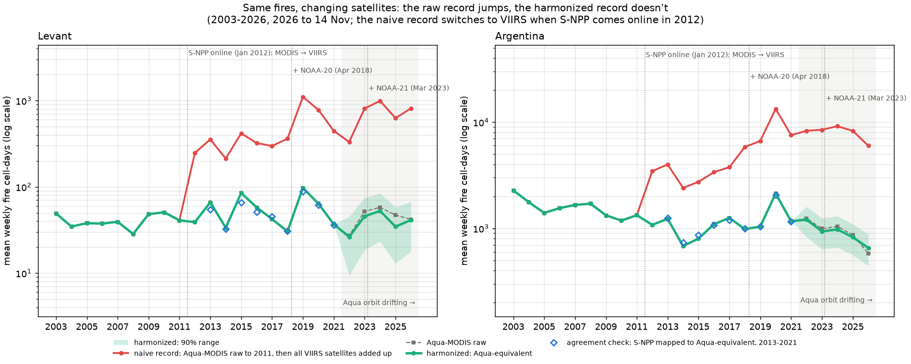

# F.I.R.E.S.: a harmonized burning activity calendar from MODIS and VIIRS

**NASA Space Apps Challenge 2026: "Harmonization of MODIS and VIIRS Hot Spots".** Team Space Jo, NASA Space Apps Amman.

Pick an area and see its burning activity week by week on **one consistent scale** across satellites: an Aqua-MODIS-equivalent count of fire cell-days, over a **15-year global record (2012–2026)** from five satellites. The app also shows the season, the unusual weeks, how this week compares with past years, and a calibrated 7-day risk outlook. Every number shows its uncertainty and its baseline, and missing data is never shown as zero fire.



*Levant and Argentina, 2012–2026. Red: the naive record, which switches from MODIS to VIIRS (simulated after 2015, inside the real 2012–2026 overlap) and then adds each new satellite's raw counts. It jumps 3.8–4.2× in 2016, again with NOAA-20 (2018) and NOAA-21 (2023): the satellites, not the fires. Green: our harmonized Aqua-equivalent series, with its 90% range from out-of-sample tests. Blue diamonds: S-NPP mapped to Aqua-equivalent on Aqua's stable-orbit years (2013–2021), where it overlaps what Aqua saw (Argentina 1.00×, Levant 0.91× over those years; these are the calibration years, so this is a consistency check, not a skill score).*

## Quickstart (fresh clone, fixture data)

```
git clone https://github.com/Khawajajr/fires-space-apps-2026.git && cd fires-space-apps-2026
python -m venv .venv && .venv\Scripts\python -m pip install -e .        # macOS/Linux: .venv/bin/python
.venv\Scripts\python -m godseye demo                                     # then open http://127.0.0.1:8000/
```

`demo` builds a few hundred committed FIRMS rows into `data/demo` and serves the app. With real data, the full pipeline is:

```
python -m godseye clean data\raw && python -m godseye aggregate
python -m godseye ingest-archive          # the 39 global FIRMS archive zips 2012-2025, read in place (~15 min, parallel)
python -m godseye harmonize
python -m godseye train-v2 --climatology && python -m godseye evaluate && python -m godseye api
```

## What it does

- **Burning activity calendar** (`/`): a year × week grid per area (named areas or a box drawn on the map) of Aqua-equivalent fire cell-days, with a 90% range. Each raw sensor series is a toggle away, and sensors are never added together.
- **Season and history:** the seasonal profile, critical periods, unusual weeks and "this week vs history", from 15 years **for any box you draw on Earth** (global 0.25° tiles, 2012–2026, loaded per box) and for the named areas (Levant, Jordan, Argentina, and two focused areas chosen in advance, ADR 0008: the Northern Jordan forest belt and the Paraná Delta's Islas de Victoria). An area needs ≥ 5 years, and the app says so instead of guessing.
- **Current:** data runs to 14 Nov 2026 (FIRMS near-real-time); the 7-day outlook is issued from the last full day.
- **Next 7 days:** a calibrated chance of satellite-detected fire per 0.25° cell, with its test-block skill shown next to the persistence baseline.
- **3D globe** (optional, the gods-eye-view fork): Active Fires, a Wildfire Risk layer, and agent tools that answer "is this week unusual for northern Jordan?". See `integrations/gods-eye-view/README.md`.

## Results (held-out tests, except the drift check)

| What | Result | Baseline |
|---|---|---|
| NOAA-20 → S-NPP continuity (2018–2026, 9 yearly folds) | no correction needed (ratio 0.994, 90% CI 0.992–0.996) | global ratio: ties within noise |
| NOAA-21 → S-NPP continuity (2023–2026, 4 yearly folds) | ×1.027 (CI 1.026–1.029), region-month WAPE 0.033 | no correction: 0.042 |
| S-NPP → Aqua-equivalent (2013–2021, 9 yearly folds) | region × month ratios (shrunk), region-month WAPE 0.086 | one global ratio: 0.242 |
| 90% bands | 90.7–92.0% coverage on held-out years | target 90% |
| Aqua drift check (observed / predicted, global) | 0.97–1.04 in 2013–2025; **0.905 in 2026** | 1.00 |
| 7-day risk v2.1, test block 2–30 Oct 2026 | ROC-AUC 0.880, PR-AUC 0.749, Brier 0.102 | persistence 0.749 / 0.456 / 0.133; NOAA-20 2019–2025 climatology 0.816 / 0.605 / 0.127 |
| Brier skill score | +0.228 vs persistence, +0.194 vs climatology; new activity +0.121 / +0.143 | 0 |

Also measured: Aqua's daytime overpass has drifted to about **15:24 local time** in 2026 (S-NPP 13:34); the drift check shows Aqua tracking the calibration until 2025 and reading 9.5% low in 2026. Over 2012–2025, S-NPP has 35 no-data and 47 partial-delivery days, and NOAA-20 6 and 36; all are marked, never read as zero. ROC-AUC is a ranking measure, not accuracy. Reproduce: `python -m godseye harmonize` and `python -m godseye evaluate`.

## Limitations

- **Very large boxes** (more than ~30 million daily cell rows, roughly 40° × 40° in fire-heavy regions) fall back to the latest year and say so; draw a smaller box.
- **2012–2026 only.** The FIRMS archive we use starts in 2012, so there is no Terra-only segment (2000–2002) and no real MODIS-only era; the MODIS → VIIRS switch in the headline figure is simulated inside the overlap and labelled so.
- **Critical periods under a rule fixed in advance (ADR 0006):** Argentina, Jordan and the Paraná Delta count as active all year (the app says so); the Levant's period is 45 weeks; the Northern Jordan forest belt averages 0.2 fire cell-days a week, below the floor, so it shows "too little detected activity to define critical periods". We report this rather than retune the rule.
- **The risk model is trained on 2026** (with 2019–2025 only as a climatology); validation and test are Aug–Oct.
- Cloud cover is not mapped: a low count can mean cloud, not absence of fire.
- Counts are of kept detections (nominal/high confidence vegetation fires). Agricultural burning counts as fire.
- The risk outlook only scores cells where NOAA-20 has seen fire, and it is a planning aid, not an ignition forecast. See `docs/MODEL_CARD.md`.

## Documentation

`docs/METHODOLOGY.md` · `docs/DATA_CARD.md` · `docs/MODEL_CARD.md` · `docs/ARCHITECTURE.md` · `GLOSSARY.md` · `docs/adr/` · `docs/REFERENCES.md` · `docs/AI_USAGE.md`

## Credits

NASA FIRMS (MODIS C6.1, VIIRS 375 m C2): "We acknowledge the use of data and/or imagery from NASA's Fire Information for Resource Management System (FIRMS), part of NASA's Earth Science Data and Information System (ESDIS)." Natural Earth (public domain). Leaflet (BSD-2). The globe builds on **gods-eye-view by Bilawal Sidhu (MIT)**. Full list: `docs/REFERENCES.md`. Code: MIT (see `LICENSE`).
