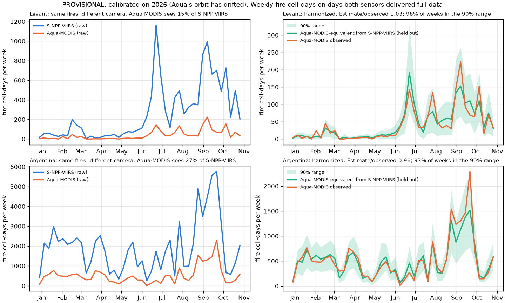

# F.I.R.E.S.: a harmonized burning activity calendar from MODIS and VIIRS

**NASA Space Apps Challenge 2026: "Harmonization of MODIS and VIIRS Hot Spots".** Team Space Jo, NASA Space Apps Amman.

Pick an area and see its burning activity week by week on **one consistent scale** across satellites: an Aqua-MODIS-equivalent count of fire cell-days. The app also shows the season, the unusual weeks, how this week compares with past years, and a calibrated 7-day risk outlook. Every number shows its uncertainty and its baseline, and missing data is never shown as zero fire.



*Raw VIIRS sees 4 to 7 times more fire than MODIS: the sensor, not the fire, makes the jump. Our held-out harmonized estimate tracks what Aqua-MODIS saw (Levant 1.03×, Argentina 0.96×; 93–98% of weeks inside the 90% range). Provisional: calibrated on 2026, when Aqua's orbit had drifted.*

## Quickstart (fresh clone, fixture data)

```
git clone https://github.com/Khawajajr/fires-space-apps-2026.git && cd fires-space-apps-2026
python -m venv .venv && .venv\Scripts\python -m pip install -e .        # macOS/Linux: .venv/bin/python
.venv\Scripts\python -m godseye demo                                     # then open http://127.0.0.1:8000/app/
```

`demo` builds a few hundred committed FIRMS rows into `data/demo` and serves the app. With real data, the full pipeline is:

```
python -m godseye clean data\raw && python -m godseye aggregate && python -m godseye harmonize
python -m godseye train-v2 && python -m godseye evaluate && python -m godseye api
```

## What it does

- **Burning activity calendar** (`/app/`): a year × week grid per area (named areas or a box drawn on the map) of Aqua-equivalent fire cell-days, with a 90% range. Each raw sensor series is a toggle away, and sensors are never added together.
- **Season and history:** the seasonal profile, critical periods, unusual weeks and "this week vs history". These need ≥5 years of history and say so instead of guessing (more years are being ingested).
- **Next 7 days:** a calibrated chance of satellite-detected fire per 0.25° cell, with its test-block skill shown next to the persistence baseline.
- **3D globe** (optional, the gods-eye-view fork): Active Fires, a Wildfire Risk layer, and agent tools that answer "is this week unusual for northern Jordan?". See `integrations/gods-eye-view/README.md`.

## Results (all out of sample)

| What | Result | Baseline |
|---|---|---|
| NOAA-20 → S-NPP continuity | no correction needed (ratio 0.993, 90% CI 0.983–1.001) | global ratio: ties within noise |
| NOAA-21 → S-NPP continuity | ×1.027 (CI 1.021–1.031), region-month WAPE 0.033 | no correction: 0.043 |
| S-NPP → Aqua-equivalent (provisional) | region ratios, region-month WAPE 0.203; band coverage 92.6% | one global ratio: 0.227 |
| 90% bands | 90.5–92.6% coverage on held-out months | target 90% |
| 7-day risk, test block 2–30 Oct 2026 | ROC-AUC 0.867, PR-AUC 0.731, Brier 0.106 | persistence: 0.749, 0.456, 0.133 |
| Brier skill vs persistence | +0.197 (all cells), +0.089 (new activity) | 0 |

Also measured: Aqua's daytime overpass has drifted to about **15:24 local time** (S-NPP 13:34). S-NPP had **14 outage days and 10 partial-delivery days** in 2026; these are marked, never read as zero. ROC-AUC is a ranking measure, not accuracy. Reproduce: `python -m godseye harmonize` and `python -m godseye evaluate`.

## Limitations

- **Only 2026 is on disk so far.** The 2018–2021 calibration (Aqua's stable orbit) and the multi-year calendar arrive with the FIRMS archive download. Until then the Aqua-equivalent link is **provisional**.
- Cloud cover is not mapped: a low count can mean cloud, not absence of fire.
- Counts are of kept detections (nominal/high confidence vegetation fires). Agricultural burning counts as fire.
- The risk outlook only scores cells where NOAA-20 has seen fire, and it is a planning aid, not an ignition forecast. See `docs/MODEL_CARD.md`.

## Documentation

`docs/METHODOLOGY.md` · `docs/DATA_CARD.md` · `docs/MODEL_CARD.md` · `docs/ARCHITECTURE.md` · `GLOSSARY.md` · `docs/adr/` · `docs/REFERENCES.md` · `docs/AI_USAGE.md`

## Credits

NASA FIRMS (MODIS C6.1, VIIRS 375 m C2): "We acknowledge the use of data and/or imagery from NASA's Fire Information for Resource Management System (FIRMS), part of NASA's Earth Science Data and Information System (ESDIS)." Natural Earth (public domain). Leaflet (BSD-2). The globe builds on **gods-eye-view by Bilawal Sidhu (MIT)**. Full list: `docs/REFERENCES.md`. Code: MIT (see `LICENSE`).
